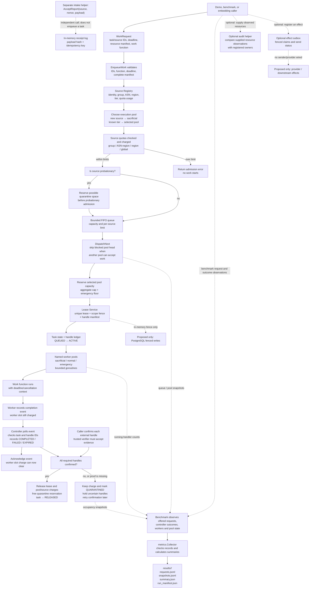
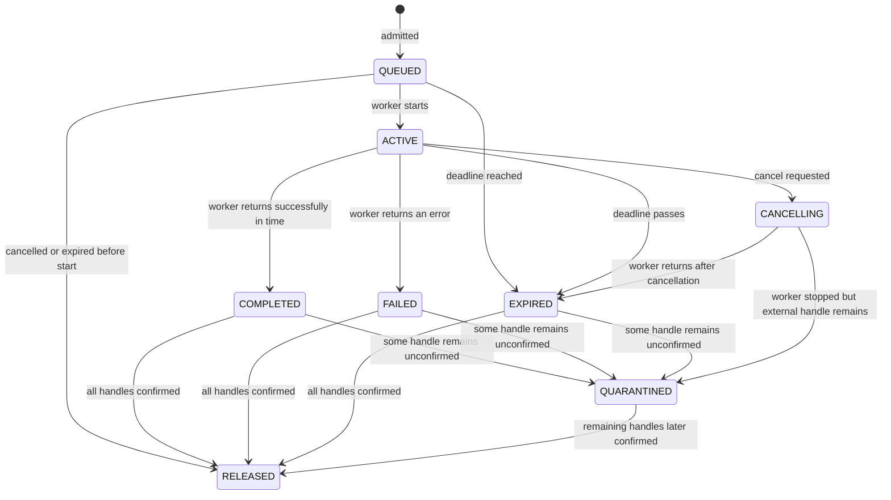
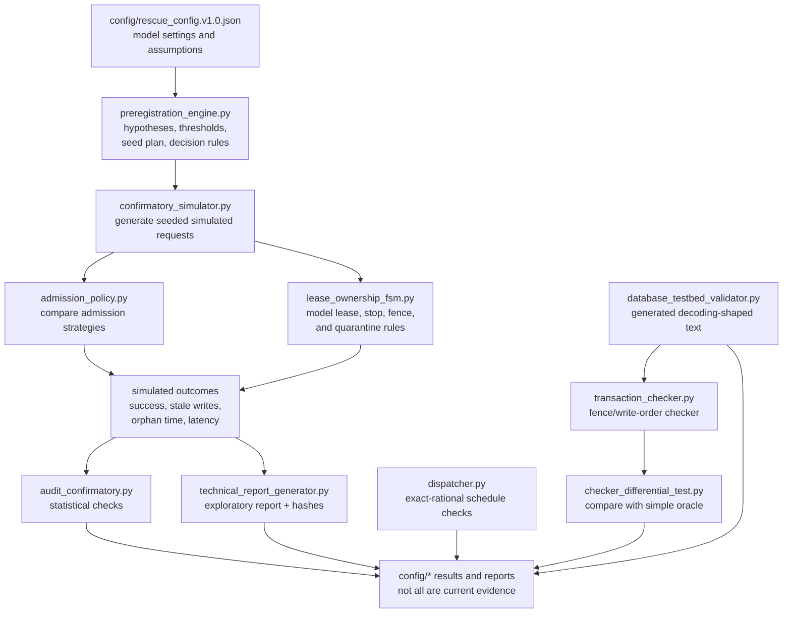

# RESCUE project guide

This guide explains what is in the repository, what each part does, how data
moves through it, and why the parts exist. It is written for readers who want
to follow the code without needing to know distributed-systems terminology.

> **Important:** RESCUE is a research prototype. It is not connected to
> emergency services and is not production infrastructure. The Go gateway is
> in-memory. The Python database checks use generated examples, not a live
> PostgreSQL server. Diagrams below distinguish working prototype paths from
> ideas that are still proposed.

## 1. The problem RESCUE studies

When a system is busy, it must decide which work to accept and how much
capacity to promise to each request. A request may time out at the caller
while its worker continues running. If the system treats that timeout as proof
that the worker stopped, it may assign the same capacity to more work while
the old work is still using it.

RESCUE models a safer rule:

1. Check that source and system limits allow the work.
2. Reserve capacity before the work starts.
3. Give the work a task record, a resource list, and a lease version.
4. If the caller times out or asks to cancel, request cancellation but keep
   charging the capacity.
5. Release the charge only after the worker has actually returned and each
   other required resource has been confirmed released.
6. If any resource cannot be confirmed, keep the task charged and mark it
   quarantined rather than pretending it is free.

Here, a **resource handle** is the ID used to track one thing a task uses,
such as its worker slot or a caller-declared external resource. A **lease** is
the record that says which task owns those handles and which version of the
scope is current. A **fence** is that version number; it is intended to help
reject work from an older owner.

## 2. System block diagram: implemented Go prototype

The solid arrows show the executable in-memory path used by the Go demo and
benchmark. Dashed arrows are separate helper surfaces: they exist in code but
are not automatically part of the worker request path.



The dashed PostgreSQL and provider blocks are shown to explain the intended
larger design. They are **not** connected implementations: the Go lease and
outbox versions are stored in memory, and no live database or provider client
is wired into the demo.

## 3. Go request flow, step by step

### 3.1 The caller describes work

The main runnable path starts when a caller creates a `WorkRequest` and calls
`Controller.EnqueueWork`.

The request contains:

- `TaskID`: unique name for this unit of work.
- `SourceID`: identity used to apply per-source limits.
- Optional source group, ASN, and region, which group traffic for quota
  checks. Missing values get simple defaults in the prototype.
- Optional preferred `Pool` and `Scope`.
- Optional deadline.
- `RequiredHandles`: external resources that must later be confirmed released.
- `HandleManifestComplete`: must be true, even if the resource list is
  intentionally empty. This prevents admitting work while hiding unknown
  resources.
- `Work`: the function the worker will run.

`EnqueueWork` rejects missing IDs, a missing worker function, an incomplete
manifest, an already-passed deadline, repeated task IDs, and unregistered
worker pools. This happens first so malformed work does not consume queue or
source capacity.

### 3.2 Source registration, tier, and quotas

`source.Registry` keeps source identity and usage counts. A source not seen
before starts as **probationary**. In the controller path, probationary work
is sent to the `sacrificial` pool even if the caller requested another pool.
That keeps new or unproven work away from the normal pool in this model.

The registry checks and records usage at these scopes:

- **Group**: several source IDs can share one group allowance.
- **ASN + region**: traffic from the same network group in the same region
  shares an allowance.
- **Region**: all sources in a region share an allowance.
- **Global**: all sources share the overall allowance.

`CheckAdmission` checks whether a request fits; `Reserve` atomically adds its
charge at every scope; `Release` returns the charge later. The current
prototype charges one unit per task. It does not measure real CPU, database
connections, or provider usage.

`Promote` can change a source's tier, but the prototype does not decide when a
source has earned promotion. There is no live trust-scoring or attestation
service.

### 3.3 Pool choice and protected capacity

`pool.Policy` separately tracks execution capacity:

- A **pool limit** prevents one named pool from exceeding its configured size.
- An **aggregate limit** prevents all pools together from exceeding total
  capacity.
- An **emergency floor** prevents non-emergency work from using the protected
  portion of total capacity.

`CanUse` checks a reservation, `Reserve` records it, and `Release` returns
it. `ChoosePool` maps probationary sources to sacrificial, emergency-tier
sources to emergency, and the rest to normal unless the selected policy says
otherwise.

These are in-memory counters. They are not operating-system CPU limits or
database connection limits. The capacities are prototype settings, not
measured deployment values.

### 3.4 Probation quarantine space and the bounded queue

Before probationary work enters the queue, the controller reserves a possible
quarantine slot. The reason is practical: if work later fails to stop cleanly,
the system has space to keep tracking it. If that reservation cannot be made,
probationary admission pauses. If the task finishes cleanly, the reservation
is returned; if it must be quarantined, the reservation is transferred into
the quarantine entry.

`queue.Queue` then checks:

- Total queue capacity.
- Per-source queue limit.
- Duplicate or blank task/source IDs.
- Deadline expiry.

Items are stored in arrival order. The queue's `Priority` field is data only:
the current queue does not sort by priority. The controller normally scans in
FIFO order but may skip an item whose pool is full and run a later item from a
pool with available capacity. `BlockedFrontDispatches` counts that case. This
prevents one full pool from unnecessarily holding back another pool; it is
not a separate first-contact lane.

If admission or enqueueing fails, the controller returns the source charge
and any quarantine reservation already taken.

### 3.5 Lease and task setup happen before execution

`DispatchNext`:

1. Sweeps expired queued work.
2. Finds the earliest queued item whose worker pool and pool budget can accept
   it.
3. Reserves one pool-budget unit.
4. Removes the item from the queue.
5. Creates a unique worker-handle ID and combines it with all caller-declared
   external handles.
6. Calls `lease.Service.Begin` to create a lease and advance that scope's
   in-memory fence version.
7. Writes the lease ID, pool, and handles onto the task record.
8. Moves the task from `QUEUED` to `ACTIVE`.
9. Starts the function on the named worker pool with a deadline-aware context.

Creating the lease before starting the worker makes the ownership record
available before work can run.

The task state machine distinguishes work outcome from resource release:



`COMPLETED`, `FAILED`, and `EXPIRED` say what happened to the work.
`RELEASED` means all tracked resources have been confirmed gone and charges
were returned. A failed task can therefore still be using capacity until its
handles are confirmed.

### 3.6 Worker completion is not the same as freeing the slot

Each `worker.Pool` has a hard maximum number of active slots. A worker runs
the supplied function in a goroutine and records a `CompletionEvent` when the
function returns (including when it returns an error or panics).

The event includes task and handle IDs, duration, error, and whether the
context was cancelled or timed out. It remains pending until the controller
reconciles it and calls `AcknowledgeCompletion`. The slot remains charged
while the event is waiting to be acknowledged.

This is why timeout and cancellation are requests, not proof of stopping:

- A cooperative function sees the cancelled context and returns.
- A function that ignores the context keeps running.
- Until that function returns and its completion event is reconciled, the
  worker slot and source charge remain held.

`ReconcileCompletions` polls the worker pools. `WaitTask` repeatedly invokes
reconciliation until a task is released or quarantined, or the caller's wait
context ends.

### 3.7 External handle confirmation and quarantine

The worker pool can confirm its own worker slot because it knows the function
has returned. It cannot prove that some external database connection,
subprocess, or provider operation has stopped. For those, the caller must
invoke `Controller.ConfirmHandle` with evidence.

The configured `HandleReleaseVerifier` must accept that evidence for the
specific task/handle pair. Constructors without a verifier fail closed for
external release confirmation. A worker-slot handle cannot be confirmed this
way; it must come from the worker completion event.

If all handles are confirmed, `releaseTask`:

- Releases the lease.
- Removes any quarantine entry or unused quarantine reservation.
- Returns the pool charge.
- Returns the source quota charge.
- Moves the task to `RELEASED`.

If one or more handles are still uncertain, `finishOrQuarantine` records the
remaining handles and keeps their capacity charged. A later successful
`ConfirmHandle` can finish release.

The quarantine pool has a total limit and an emergency minimum reserve.
Non-emergency entries cannot consume that reserved portion; emergency entries
may use it. Probationary work reserves space in advance, while normal work
does not have that same pre-admission reservation in the current controller.
Quarantine tracking is in memory, and it does not itself stop or inspect a
real resource.

### 3.8 Receipt intake is a separate helper path

`Controller.AcceptReport` is a small in-memory intake helper. It:

1. Normalizes a missing source ID to `anonymous`.
2. Computes an idempotency key from source ID and nonce.
3. Hashes the payload with SHA-256.
4. Returns the earlier receipt if the same key and same payload are repeated.
5. Rejects the same key with a different payload.
6. Temporarily checks/reserves source quota while making the receipt.
7. Releases that temporary source charge when the receipt operation ends.

This method **does not enqueue work**. There is no HTTP API or built-in
connection from a receipt to `EnqueueWork`; an embedding caller would have to
connect those steps itself. `IntakeLog` is a Go map in memory. Its `FsyncOK`
flag is not a disk write or a real `fsync`, so the returned receipt is not
durable across a process crash.

### 3.9 Optional audit and effect helpers

These components are present but are not automatically run by the main
worker path:

- `RecordRuntimeAudit` passes a caller-supplied list of observed resources to
  `audit.ReverseAuditor`. The auditor reports resources with a blank ID,
  blank owner, unknown resource ID, or owner mismatch. It does not enumerate
  Linux processes, cgroups, database sessions, or provider operations.
- `RegisterEffect` adds an effect to the in-memory `effect.Outbox`. The outbox
  tracks `PENDING`, `CLAIMED`, `SENT`, and `FAILED`, including a claim owner,
  expiry, token, and fence. Stale claim tokens or changed fences cannot mark
  an effect sent. No provider sender or persistent shared fence store is
  connected.
- The standalone `admission.Service` offers another manifest-and-release
  ledger with a verifier. The controller's normal `EnqueueWork` path does not
  call this package; it performs its task/lease accounting directly.

## 4. What the Go demonstration and benchmark do

### Demo

`gateway/cmd/rescue-demo` creates a controller, registers a small sacrificial
pool, admits one new (therefore probationary) source, dispatches a short
timer-backed function, waits for its completion event to be reconciled, and
prints the task snapshot as JSON. It demonstrates the in-memory lifecycle; it
does not process a real report or use a database.

### Benchmark

`gateway/cmd/rescue-bench` creates a seeded generated workload and sends
requests through the Go controller. It can vary arrival rate, duration,
worker count, work time, deadline, first-contact sources, mixed pools, and
sacrificial-pool saturation.

For each request, the benchmark records timing and outcome details such as
arrival, admission/rejection, start, completion, deadline success, and work
error. Every 50 ms it samples system state such as pool occupancy, free
workers, queue lengths by pool, blocked-front dispatches, quarantine count,
and recorded versus instrumented-running capacity.

It writes a new run directory under `results/` by default:

| File | What it contains | Why it is saved |
| --- | --- | --- |
| `requests.jsonl` | One request outcome and timing record per line. | Allows later analysis by request or class. |
| `snapshots.jsonl` | Periodic system-state samples. | Shows what the controller and worker instrumentation saw over time. |
| `summary.json` | Success, goodput, latency percentiles, and counts. | Convenient aggregate view of the run. |
| `run_manifest.json` | Seed, settings, time window, OS/CPU/Go version, revision, dirty status, and hashes. | Makes the run easier to reproduce and identify. |

`S_L` is legitimate-request deadline success. `S_F` is first-contact
legitimate-request deadline success when that workload is enabled. In-window
goodput counts completions whose completion time is inside the fixed
measurement window; these measures have different definitions and should not
be substituted for one another.

The workload's “legitimate” and “attacker” labels are for later analysis;
they do not alter controller decisions. Work consists of timer-backed stubs,
not database writes, emergency communications, or provider requests. A Go
benchmark run is not the same as the registered Python experiment.

## 5. Python research and checking components

The Python files form a second track. They model behavior, test rules on
generated inputs, and analyze experiment results. They do not call the Go
controller as a live service.



| File or group | What it does | Why it is in the project | What it does **not** prove |
| --- | --- | --- | --- |
| `admission_policy.py` | Contains the adaptive limiter, datastore-aware (DRACO-inspired) policy, reservation policy, and execution-arm settings used by models. | Lets the experiment compare different admission choices. | It is not a faithful independent reproduction of DRACO; some elements are simplified or omitted. |
| `dispatcher.py` | Simulates FIFO, work-conserving job assignment with exact fractions; can run deliberate faulty variants (mutants). | Checks the scheduling math and whether tests catch known bad behavior. | It is not a measurement of real worker performance. |
| `lease_ownership_fsm.py` | Models lease states, cancellation, owner confirmation, fencing, and quarantine; checks invariants across generated sequences. | Makes lifecycle rules and capacity effects testable. | It does not manage real processes or cgroups. |
| `transaction_checker.py` | Reads transaction-shaped records, applies fence changes and validates writes before applying each transaction; includes a reference oracle. | Tests stale-write detection, replay handling, mixed transactions, and audit/data relationships. | Its data is generated/in-memory, not a PostgreSQL WAL feed. |
| `checker_differential_test.py` | Generates many histories and compares the checker to the reference oracle; plants stale and legitimate-late cases and mutants. | Finds disagreements and checks that known faults are detected. | Passing generated histories is not live database evidence. |
| `database_testbed_validator.py` | Generates `test_decoding`-style text, parses it, applies checker rules, and writes a mock report. | Exercises the planned PostgreSQL decoding path before the real testbed exists. | It explicitly does not connect to PostgreSQL or read a real WAL stream. |
| `confirmatory_simulator.py` | Generates seeded request traces, simulates policy arms and faults, and calculates model outcomes. | Explores the registered workload and hypotheses in a repeatable model. | The simulation result is not an outcome from a deployed service. Check `phase.md` for the active result and status. |
| `preregistration_engine.py` | Creates/fixes hypotheses, thresholds, seed blocks, sample-size rules, and statistical decision rules; hashes the registration. | Reduces the chance of changing the experiment after seeing results. | A frozen plan does not mean the system or experiment is fully validated. |
| `fault_calibrator.py` | Estimates a stop-failure rate from supplied trial data and computes an interval. | Makes an assumed failure rate explicit in model inputs. | Current calibration trials are synthetic, not measured from real cancellation attempts. |
| `audit_confirmatory.py` | Independently recalculates statistics for an older confirmatory artifact. | Provides a second calculation path for statistical results. | Historical artifacts can be superseded or invalid; check their metadata and `phase.md` before using them. |
| `technical_report_generator.py` | Reads results explicitly marked exploratory, computes summaries, and records input/source hashes. | Produces a traceable exploratory summary without presenting it as confirmatory. | It does not turn exploratory results into confirmatory evidence. |
| `*_test.py`, `*_bound_test.py` | Run unit, boundary, mutant, or large generated-case checks. | Catch regressions and check defined model properties. | Synthetic checks do not replace measurements against real infrastructure. |

The exact-rational dispatcher and transaction checker are intentionally separate
from the Go request handler: one checks mathematical scheduling properties;
the other checks transaction/fence logic on records. They answer different
questions.

## 6. Data and files: where information comes from and goes

| Location | Role |
| --- | --- |
| `gateway/pkg/` | Go implementation modules and their package tests. |
| `gateway/cmd/rescue-demo/` | Small end-to-end in-memory example. |
| `gateway/cmd/rescue-bench/` | Seeded Go-controller workload and JSON/JSONL data collection. |
| `harness/` | Python simulation, model checks, generated-history checks, and analysis. |
| `config/rescue_config.v1.0.json` | Versioned assumptions, stages, request classes, policies, and workload settings for the research model. Values are not measured production limits. |
| `config/fencing_schema.sql` | PostgreSQL fencing design/schema artifact. It is not automatically applied by the Go code. |
| `config/preregistration_*.json` | Frozen or repaired experiment plans and provenance. Check status before treating one as current. |
| `config/confirmatory_results_*.json` | Historical or repaired model results with distinct statuses. Do not treat every filename containing “confirmatory” as valid current evidence. |
| `config/database_testbed_report*.json` | Mock or invalidated database-testbed reports, not live database output. |
| `results/` | Go timer-workload benchmark outputs, when a benchmark is run. |
| `schemas/run_manifest.schema.json` | Shape of a reproducibility manifest. |
| `scripts/validate.py` | Runs the Python checks, Go tests, race tests, and Go static checks locally. |
| `.github/workflows/ci.yml` | Runs the project checks in GitHub Actions on Linux and on the supported Python versions. |
| `docs/new_br.md` | Target requirements and acceptance evidence (what is wanted). |
| `docs/new_arhitecture.md` | Proposed design (how it may be built). |
| `docs/phase.md` | Current completion status, evidence limits, and next work (what is actually evidenced). |

The usual data path in the **Go benchmark** is:

```text
fixed command-line settings + random seed
  → seeded request arrivals and work durations
  → EnqueueWork / DispatchNext / worker goroutines
  → completion reconciliation and task snapshots
  → per-request records + periodic state snapshots
  → summary + run manifest + hashes in results/
```

The usual data path in the **Python research checks** is:

```text
configuration / registration
  → generated request or transaction histories
  → simulated policy, lease, schedule, or transaction checker
  → assertions and statistical calculations
  → JSON results/reports in config/ or console test output
```

These tracks do not automatically feed one another. A Go benchmark result is
not inserted into the Python confirmatory analysis; a Python mock result is
not proof of the Go runtime's PostgreSQL behavior.

## 7. Components, public operations, and their roles

This is a practical map of the main Go package responsibilities and commonly
used operations. It is not a claim that every helper is connected to a
production service.

| Go package | Main operations | Contribution |
| --- | --- | --- |
| `controller` | `NewController`, `RegisterPool`, `EnqueueWork`, `DispatchNext`, `WaitTask`, `ReconcileCompletions`, `CancelTask`, `ConfirmHandle`, `TaskSnapshot` | Joins source checks, pool choice, queueing, leases, workers, completion, quarantine, and release. |
| `source` | `RegisterSource`, `CheckAdmission`, `Reserve`, `Release`, `Promote`, `ChoosePool` | Tracks source identities, tiers, hierarchical usage, and pool choice. |
| `pool` | `RegisterPool`, `CanUse`, `Reserve`, `Release`, `ChoosePool` | Prevents pool or total capacity overrun and protects the emergency floor. |
| `queue` | `Enqueue`, `Snapshot`, `RemoveForDispatch`, `RemoveExpired`, `Remove`, `Stats` | Bounds waiting work and enforces per-source queued limits; maintains FIFO order. |
| `lease` | `Begin`, `ConfirmHandle`, `AllHandlesConfirmed`, `CurrentFence`, `Release`, `Snapshot` | Records lease ownership, handle lists, and a changing in-memory fence version. |
| `task` | `New`, `TransitionTo`, `AddHandle`, `ConfirmHandle`, `Snapshot` | Stores the task state history and state of each resource handle. |
| `worker` | `SubmitWithHandle`, `Cancel`, `PendingCompletions`, `AcknowledgeCompletion`, `WaitDrain`, `Shutdown` | Runs bounded Go worker goroutines and keeps a finished worker slot charged until its completion is reconciled. |
| `quarantine` | `ReserveSlot`, `Add`, `ConfirmHandle`, `Release`, `IsFull`, `Snapshot` | Keeps tasks/resources that are not fully confirmed accounted for; has a fixed capacity and emergency reserve. |
| `intake` | `PayloadHash`, `IdempotencyScope`, `Accept`, `ReceiptForKey` | Creates in-memory receipts and rejects duplicate keys with different payloads. |
| `admission` | `Admit`, `ConfirmRelease`, `Snapshot` | Standalone admission/manifest ledger with verifier support; not used by `Controller.EnqueueWork`. |
| `audit` | `RegisterOwner`, `Audit` | Compares externally supplied observations with known owners and flags mismatches/orphans. |
| `effect` | `Add`, `Claim`, `CanSend`, `MarkSent`, `MarkFailed`, `Retry`, `BumpFence` | Tracks fenced effect claims in memory; there is no actual downstream sender. |
| `metrics` | `Record`, `AddSnapshot`, `ComputeSummary`, `ExportJSONL`, `ExportSummaryJSON` | Validates and summarizes measured request records and time-series snapshots. The benchmark supplies the observations. |

### Controller calls to know first

- `EnqueueWork`: validate and reserve the request before it waits.
- `DispatchNext`: choose runnable queued work, create lease/handles, then start
  the worker.
- `WaitTask`: repeatedly reconcile worker completion while waiting for a final
  `RELEASED` or `QUARANTINED` state.
- `ReconcileCompletions`: read completion events, update lease/task state, and
  acknowledge events only after successful handling.
- `CancelTask`: request cancellation; does not itself release capacity.
- `ConfirmHandle`: accept external release proof only after verifier approval.
- `AcceptReport`: issue/replay an in-memory report receipt; separate from
  enqueueing executable work.
- `RecordRuntimeAudit`: audit a list supplied by the caller; no discovery
  mechanism is built in.
- `RegisterEffect`: register an outbox entry; sending is not implemented.

`EnqueueTask` is retained only to return an explicit error directing users to
`EnqueueWork`. The separate `LeaseTask` / `ReleaseLease` methods are a
standalone lease-accounting path, not the regular worker dispatch flow.

## 8. How this maps to the requirements

The business requirements in `docs/new_br.md` describe the target behavior;
they are not proof that behavior is fully implemented. The relevant code and
tests are summarized in the BR-F01–BR-F16 matrix in
[`context.md`](context.md). Read that matrix together with
[`phase.md`](phase.md):

- Source, pool, queue, task, lease, worker, and quarantine packages implement
  important parts of admission, capacity, timeout, and release behavior.
- Intake idempotency, in-memory fences, a supplied-resource audit helper, and
  an outbox state machine exist as prototype components.
- Durable receipts, actual process/database resource discovery, PostgreSQL
  fencing integration, provider contracts, and the full evaluation protocol
  remain incomplete.
- Passing tests show that the tested code paths behaved as expected. They do
  not show that every BR acceptance criterion is complete.

## 9. Running and checking the project

From the repository root, run the consolidated local checks:

```powershell
python scripts\validate.py
```

This runs Python compilation and tests, generated checker/scheduling/
mechanism suites, Go package tests, Go race tests, and `go vet`. For the Go
race detector on Windows, the documented MSYS2 UCRT64 GCC setup in the root
README is required. `docs/phase.md` records the latest results and limitations.

Run the small Go demo from `gateway`:

```powershell
go run ./cmd/rescue-demo
```

Run the Go benchmark from `gateway` using the examples in
[`gateway/README.md`](../gateway/README.md). It writes new data under
`results/`; avoid reusing a run directory because benchmark output is intended
to be preserved by run.

## 10. Terms in plain language

| Term | Meaning here |
| --- | --- |
| Admission | Deciding whether a request may consume limited system capacity. |
| Charge | The amount of capacity currently held for a source, pool, or resource. |
| Deadline | The time by which the caller expects work to finish; passing it does not prove the worker stopped. |
| Handle | A named, individually tracked resource used by a task. |
| Lease | A record of task ownership, scope, deadline, fence version, and handles. |
| Fence | A version number used to distinguish a current owner from an older owner. |
| Idempotency key | A repeat-request key used to return the same receipt for the same report rather than create another receipt. |
| Quarantine | A tracked holding state for work whose resources are not yet confirmed released. |
| Receipt | An acknowledgement that the prototype's intake log accepted a report; in this code it is not durable. |
| Simulator | A program that imitates a system using generated inputs; its result is evidence about the model, not a live service. |
| Mutant | A deliberately faulty version used to check that a test can notice a known type of mistake. |
